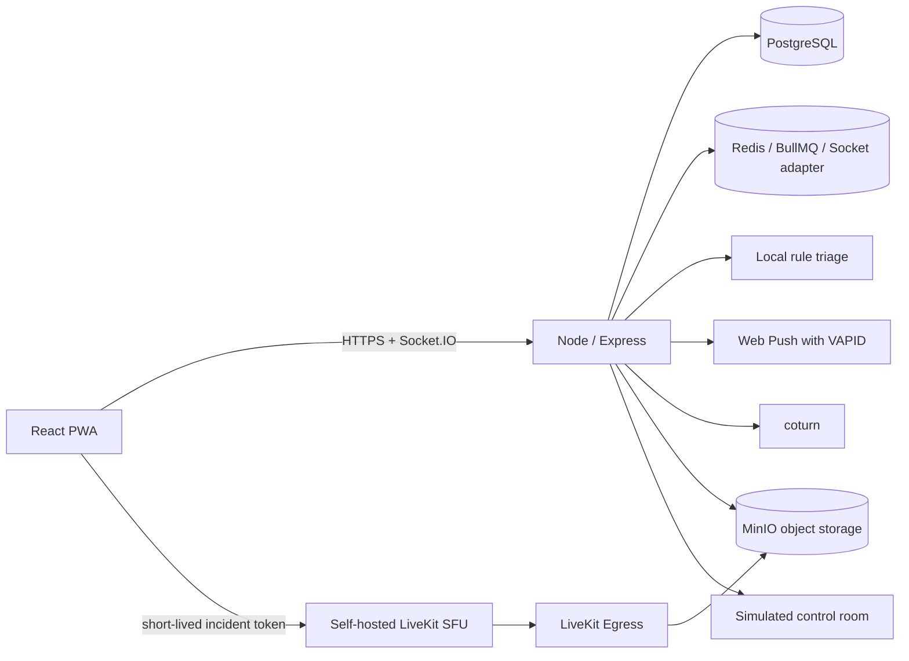

# FULE

FULE (Futuristic Use of Live Entertainment) is a self-hosted, consent-led safety network. A member can start an SOS from the app; nearby verified guardians receive a private real-time alert, rule-based triage summary, and—when configured—a private WebRTC room. Public notices use coarse location only. FULE is a prototype and supplements, never replaces, emergency services.

## Architecture



### Implementation status: wired, tested, and still unverified

The code has integration points for the following self-hosted components. “Wired” means application code/configuration calls the component; it does not mean a complete remote deployment has been exercised. Tests are primarily unit or mocked integration tests unless stated otherwise.

| Component | Code status | Test evidence | Not verified here |
|---|---|---|---|
| PostgreSQL | Wired through Knex repositories and migrations when `DATABASE_URL` is set; file-backed storage is used otherwise. | CI starts PostgreSQL, applies migrations, runs integration tests and the index/`EXPLAIN` check. | A live production database, backups, failover, and operational recovery. |
| Redis / BullMQ | Wired for Socket.IO fan-out, shared rate limits, escalation/safe-walk jobs, and cleanup when `REDIS_URL` is set. | CI starts Redis and checks connectivity; rate-limit and job logic have unit coverage. | Multi-instance delivery and timer recovery under real process failures/load. |
| LiveKit | Token/room/egress code is wired when LiveKit credentials and URLs are configured. | Mocked service tests verify token scope, revocation, recording callback handling, and evidence hashing. | Real camera-to-guardian media, network traversal, and recording in a deployed SFU. |
| coturn | Compose service and short-lived TURN credential generation are wired. | Unit test verifies generated participant-scoped credentials. | A real TURN allocation or traversal test from external networks. |
| MinIO | S3-compatible recording, object read/delete, and retention code are wired through the AWS S3 SDK. | Mocked object-reader/deleter tests cover hashing and retention logic. | A real upload/read/delete cycle against a running MinIO instance. |
| Web Push | VAPID-based delivery is wired and activates only when public/private keys are configured. | Subscription validation and persistence are tested; push transport delivery is not. | Browser push delivery through a real browser push service. |

The default local demo uses synthetic coordinates, generated test video, file-backed persistence, and simulated dispatch. Live video, push delivery, and durable multi-instance jobs require configuration and running infrastructure. The dispatch room is always a simulation; FULE does not call emergency services. The app provides a direct `tel:112` link for the user to call.

## Start the complete local stack

Install Docker Desktop or Docker Engine with Compose. From the repository root:

```powershell
Copy-Item .env.example .env
# Edit .env and replace each sample secret before sharing the machine or exposing ports.
docker compose up --build
```

Open [http://localhost:4173](http://localhost:4173). API health: [http://localhost:4000/api/health](http://localhost:4000/api/health). MinIO console: [http://localhost:9001](http://localhost:9001). The backend container applies PostgreSQL migrations before it starts.

Stop with `Ctrl+C`; use `docker compose down` to stop containers. To also erase local PostgreSQL, Redis, object, and evidence data, run `docker compose down -v`.

## Run frontend/backend directly

Requires Node.js 22.5 or newer. PostgreSQL and Redis are needed for accounts and durable jobs; the no-infrastructure demo can use the file-backed repository.

```powershell
npm run install:all
Copy-Item .env.example backend/.env
Copy-Item frontend/.env.example frontend/.env
npm run dev
```

Open the Vite URL shown in the terminal (normally `http://localhost:5173`). The API listens on port 4000. To run only the backend tests use `npm --prefix backend test`; frontend tests use `npm --prefix frontend test`; the production frontend bundle is `npm run build`.

## 60-second demo

1. **0–10s:** Open the home screen and point out the simulated stream badge and privacy note.
2. **10–20s:** Press and hold the coral SOS control for one second. Demo mode uses a synthetic member and location without camera or account setup.
3. **20–35s:** Show the generated incident card, threat level, coarse public area, guardian alert, and the 10-second cancel window.
4. **35–45s:** Open the simulated control room and accept the incoming report. Explain that it is an internal simulation.
5. **45–55s:** Open the incident evidence/case-file view and show the event timeline and integrity hash when seeded evidence is present.
6. **55–60s:** Point out the direct `Call 112` link and state that demo actions never contact emergency services.

## Accounts and guardian verification

Create a local administrator account by setting `DATABASE_URL`, `ADMIN_EMAIL`, and `ADMIN_PASSWORD` in `backend/.env`, then run:

```powershell
npm --prefix backend run create:admin
```

Members register with email and a password (minimum 12 characters); passwords are bcrypt-hashed. Access JWTs are short-lived and refresh tokens rotate. A member can request guardian status from the Guardian panel; an administrator reviews pending requests at `/api/admin/guardians/pending` and approves with `POST /api/admin/guardians/:accountId/approve` using an administrator access token.

## Self-hosted media and push setup

- Compose includes LiveKit SFU, LiveKit Egress, coturn, and MinIO. Replace all development credentials before exposing the stack beyond localhost. Set `LIVEKIT_PUBLIC_URL` to the browser-reachable secure signaling URL, set a reachable `TURN_EXTERNAL_IP` and `LIVEKIT_TURN_URL` for remote clients, and open LiveKit/coturn UDP ranges in the host firewall.
- LiveKit room credentials are scoped to an incident and expire quickly. Stream subscriptions are limited to the streamer, their trusted circle, and guardians accepted for the incident. Room access is revoked when the incident closes.
- Egress recordings are written to MinIO; each completed recording is hashed into the evidence chain. `LIVEKIT_RECORDING_RETENTION_DAYS` controls recording retention.
- Generate VAPID key material locally using `npx web-push generate-vapid-keys`; put the resulting keys in the backend environment. Keep private keys on the server.
- Browsers may deliver Web Push through their configured push transport. FULE does not use a text-message provider.

The above setup instructions describe supported wiring. They are not proof that an installation is healthy; use `/api/health`, `/api/ready`, backend logs, and the component-specific tests, then perform a deployment smoke test before relying on it.

## Rule triage evaluation

The development dataset is small, synthetic, and author-written. The old 30% test split was seen during prior analysis and is labeled “development test, previously seen”; it is not held out. **Only `holdout_v2` is held out.** Scores measure agreement with labels and do not validate real-world safety.

```powershell
 npm run eval:validate-holdout
node evals/run-triage-eval.mjs
```

The schema is `evals/holdout_v2.schema.json`; validation is implemented in `evals/holdoutValidation.mjs`. `evals/holdout_v2.json` is a clearly marked placeholder until scenarios are supplied. Add the populated dataset in its **first Git commit** before evaluating it; after that, the evaluator refuses any later Git history change or working-copy modification. Do not commit the empty placeholder if it will be replaced later. The evaluator reports aggregate-only metrics for all splits, including per-class precision/recall, per-class false-positive rate, confusion matrix, class counts, critical precision, and alert-load. It never prints individual holdout examples. `evals/BASELINE.md` contains the report and groups remaining dev errors by cause.

The old development test split remains in `evals/triage_scenarios.json` for continuity, but it has already been seen during analysis and must not be presented as an independent holdout.

## Live media integration smoke test

With Docker Desktop running, copy `.env.example` to `.env` and set local development secrets, then run:

```powershell
npm run smoke:livekit
```

The script runs `docker compose up -d --build` with demo mode disabled, creates a throwaway account and incident, publishes generated video to a real local LiveKit room for five seconds, waits for Egress to write the recording to MinIO, verifies the stored object's SHA-256 against the evidence row, and removes its throwaway incident/account and recording. It requires Docker, browser binaries installed for Playwright, and the Compose media stack. A pass is reported only after object bytes and the recorded hash match. This smoke test is separate from the regular unit suite.

## Configuration

Start with `.env.example`. Important settings include `DEMO_MODE`, `DATABASE_URL`, `REDIS_URL`, `JWT_ACCESS_SECRET`, `WEB_PUSH_PUBLIC_KEY`, `WEB_PUSH_PRIVATE_KEY`, `LIVEKIT_API_KEY`, `LIVEKIT_API_SECRET`, MinIO credentials, and `TURN_SHARED_SECRET`. Never commit `.env` files. `DEMO_MODE=true` is for local demonstrations only; it enables synthetic SOS and local video, and the dispatch control room remains labeled simulated.

## Resource and cost notes

The stack has no required per-incident SaaS fee. Local use needs Docker-compatible compute and disk. Live video and recording consume network egress, CPU, and object storage; required capacity depends on concurrent rooms, bitrate, retention, and relay share. A small single-host demo is suitable for a handful of participants, not a production capacity claim. Measure the target deployment with the included load scripts before setting a user limit. Ongoing costs are the host, storage, bandwidth, power, and any domain/network equipment chosen by the operator.

## Responsible use

FULE is a prototype and community response aid. It supplements, not replaces, emergency services (112). The simulated dispatch view does not contact authorities. Use consent-based access, keep precise location private, and do not treat generated triage as a verified fact.
