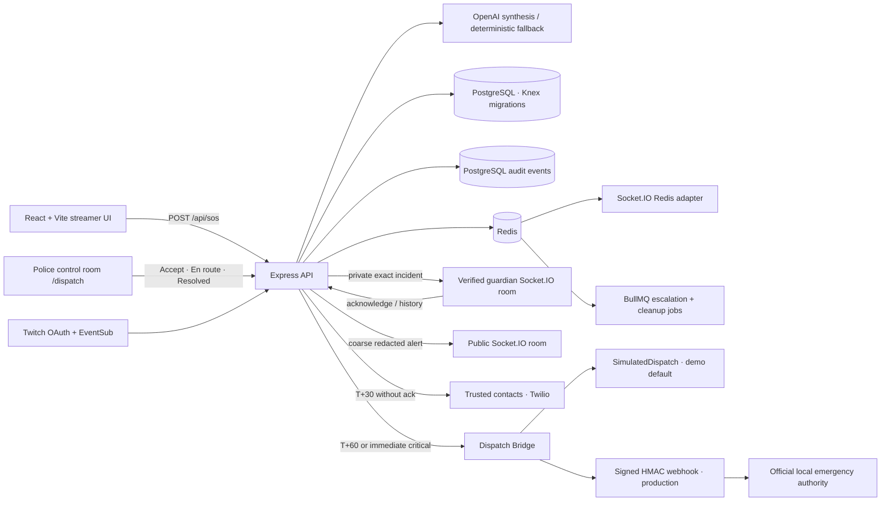

# FULE — Futuristic Use of Live Entertainment

FULE is a Twitch-centered women's safety and civic guardian network. The **FULE Protect** hackathon MVP lets a streamer raise a simulated SOS, sends a structured alert to verified guardians in real time, and records the incident for later review.

> **Responsible use:** FULE supplements, but does not replace, emergency services (112). Demo mode uses a simulated dispatch provider and never calls an emergency number. Production dispatch requires an official integration with the local emergency authority and operational approval.

## Safe Walk, nearby responders, and evidence

- **Safe Walk Check-in:** A Twitch signed-in streamer can set a destination, ETA, check-in interval, and distinct safe/duress PINs. Redis/BullMQ schedules check-ins and a 60-second response window; local demo mode persists its simulation jobs in `backend/data/demo-jobs.json`. If the check-in expires, FULE raises an SOS with the last location trail. The duress PIN returns the same visible successful check-in state while silently creating an SOS. The browser asks permission before using location, microphone, or camera. Safe and duress PINs are HMAC-hashed server side; `SAFE_WALK_PIN_PEPPER` must be private and stable across instances.
- Missed check-ins use Web Push when `WEB_PUSH_PUBLIC_KEY` and `WEB_PUSH_PRIVATE_KEY` are configured, including while the site is closed. The service worker sends a generic “Are you OK?” notification and contains no location. Without VAPID keys, the open-page demo still shows the 60-second check-in prompt.
- **Nearby guardian matching:** verified guardians can opt in to on-duty location sharing. FULE only sends a coarse area to nearby responders within `NEARBY_GUARDIAN_RADIUS_METERS` (default 400 m), nearest first; exact incident details are released after acceptance, with a default cap of five accepted responders. Location records expire from matching after 15 minutes. Responders are instructed: observe, call for help, assist only when safe; never confront.
- **Evidence Vault:** after SOS, the browser requests microphone permission and uploads 10-second audio chunks; a user can separately start audio + video. The API encrypts each stored chunk with AES-256-GCM and stores its plaintext SHA-256 hash in a hash-chained record. Verified guardians can download a JSON case file from an alert card, including incident summary, response timeline, clips, safe-walk location trail, evidence hashes, chain verification, and chunk download paths. Evidence is retained with the incident retention period.

Evidence chunk bytes use the local filesystem adapter at `EVIDENCE_STORAGE_DIR`; use a durable shared encrypted object-storage adapter before running multiple production instances. Set `EVIDENCE_ENCRYPTION_KEY` to base64-encoded 32 random bytes and retain the same key across instances; production refuses to start without it. The included local adapter is intended for development and single-host demo deployments. Browser recording is opt-in via a permission prompt and is unavailable when permission is denied.

For Web Push, generate VAPID keys with `npx web-push generate-vapid-keys` from `backend/`, set both returned values in the backend environment as `WEB_PUSH_PUBLIC_KEY` and `WEB_PUSH_PRIVATE_KEY`, and set `WEB_PUSH_SUBJECT` to an operator contact such as a `mailto:` address. The private key stays server side; browser subscriptions are stored per streamer.

## Architecture



The frontend is React + Vite. The backend is Node.js + Express + Socket.IO. `shared/incident.mjs` defines the shared incident schema and public redaction. Production uses PostgreSQL through Knex migrations, with indexes for status, creation time, and streamer. Redis backs Socket.IO multi-instance fan-out, shared rate limits, and BullMQ escalation/retention jobs. File storage is available only for local demo/test runs without `DATABASE_URL`; production startup fails closed unless PostgreSQL and Redis are configured.

Precise coordinates and private incident details go only to verified guardians, the streamer's configured trusted contacts, and the dispatch provider. Public alerts are anonymized/coarse. OpenAI receives coordinates rounded to two decimal places. Secrets remain on the backend.

## Emergency dispatch

Guardians are alerted at T+0. If nobody acknowledges by T+30 seconds, FULE notifies up to three streamer-managed trusted contacts; the demo mocks Twilio, while production uses the configured Twilio account. At T+60 seconds without acknowledgement, FULE sends the structured report to the Dispatch Bridge. `CRITICAL` incidents dispatch immediately. In demo mode the bridge uses `SimulatedDispatch`; no emergency number is called. In production, set `DISPATCH_WEBHOOK_URL` and `DISPATCH_WEBHOOK_SECRET` only after an official local emergency authority has approved the integration. Webhook requests carry an HMAC-SHA256 signature in `x-fule-signature` and retry transient failures.

Open `/dispatch` for the clearly labeled **SIMULATED DISPATCH** control room in local demo mode. Verified guardians can also access the live queue. The queue includes precise location and transcript details, so it is restricted to guardians and the local simulated dispatch view. Control-room actions update the streamer and guardian dashboards over Socket.IO. A report may be cancelled before dispatch is sent; once sent, use **Stand down** to notify the provider. The dashboard and control room include a `tel:112` action for a person to place a call themselves.

Trusted contacts can be managed from the dashboard's **Trusted Contacts** drawer/section. Store at most three E.164 phone numbers. Contact records and audit events are stored server-side. Set `TWILIO_ACCOUNT_SID`, `TWILIO_AUTH_TOKEN`, and `TWILIO_FROM_NUMBER` for production notifications; these are ignored in demo mode.

## Production runtime

The API provides `/api/health` (process liveness), `/api/ready` (database/Redis readiness), and `/metrics` (Prometheus; set `METRICS_TOKEN` to protect it). HTTP logs include request IDs. Optional Sentry reporting is enabled with `SENTRY_DSN`. Incident and audit retention defaults to 90 days and runs hourly through BullMQ. Use `DATABASE_URL`, `REDIS_URL`, and a randomly generated `JWT_ACCESS_SECRET` (at least 32 characters) in production. If Twitch OAuth is enabled, set a 32-byte `TWITCH_TOKEN_ENCRYPTION_KEY`; API tokens are AES-256-GCM encrypted in PostgreSQL, and Redis leases ensure one instance owns each broadcaster's EventSub connection. Never reuse the Compose development secrets.

Email/password accounts use bcrypt hashes, 10-minute JWT access tokens, and rotating 30-day refresh tokens. New accounts are users; guardians request approval and only an admin can approve them. Create the first admin with `backend/.env` set and `npm --prefix backend run create:admin`. The old invite flow stays available only in demo mode for backward-compatible local demos. Twitch OAuth remains the separate streamer authorization needed for Twitch APIs.

For local PostgreSQL and Redis, copy `.env.example` to both `.env` (Compose interpolation) and `backend/.env` (backend scripts), then run `docker compose up --build`; the UI is at `http://localhost:4173`, API at `http://localhost:4000`. The sample values are local-demo credentials only. `docker compose down` stops services; `docker compose down -v` also deletes local database/Redis volumes.

Existing SQLite demo data can be copied once after setting `DATABASE_URL` in `backend/.env`:

```powershell
npm --prefix backend run migrate:sqlite -- "backend/data/incidents.sqlite"
```

The actual load-test harness and measurement constraints are in [load-tests/README.md](load-tests/README.md) and [LOAD_TEST_REPORT.md](LOAD_TEST_REPORT.md). No performance figures are published until a test run produces them.

## Local quickstart

Requirements: Node.js 22.5+ and npm. From the repository root in PowerShell:

```powershell
npm run install:all
Copy-Item .env.example backend/.env
Copy-Item frontend/.env.example frontend/.env
npm run dev
```

Open the Vite URL shown in the terminal (normally `http://localhost:5173`). If that port is busy, Vite automatically selects the next free port; demo-mode CORS accepts localhost Vite ports 5173–5199. The API uses port 4000. Keep `DEMO_MODE=true` in `backend/.env` and `VITE_DEMO_MODE=true` in `frontend/.env` for local demonstration. The demo invite comes from `FULE_DEMO_GUARDIAN_INVITE` in `backend/.env`; the sample value is local demo-only. Change it for your local run. Set both demo flags to `false` for real Twitch login and geolocation requirements. Never enable demo mode or use the sample invite on a public deployment.

## 60-second demo walkthrough

Start both servers with `npm run dev`, open the dashboard, and use the invite configured by `FULE_DEMO_GUARDIAN_INVITE` in `backend/.env`.

1. **0–8 sec — Orient:** Point out the **DEMO MODE** label, the FULE Protect hero, and the guardian alert panel. Explain that all seeded identities and locations are synthetic.
2. **8–18 sec — Choose a scenario:** In **Demo Triggers**, select **Walking alone at night**. Show the editable transcript and select **Button SOS** as the trigger source.
3. **18–30 sec — Trigger:** Click **Button SOS**. Show the incident card appearing immediately with threat level, concise summary, simulated area and 10-second cancel window. The public view receives only anonymized information.
4. **30–40 sec — Safety controls:** Point out the cancel toast and loud alarm toggle. If the alarm is enabled, browser audio permission may be needed. Cancel the first simulated alert inside the grace period to demonstrate the cancel event.
5. **40–53 sec — Guardian response:** Trigger once more and, in the verified guardian panel, show the alert state and click **ACKNOWLEDGE & DISPATCH**. The incident state and audit history update; demo actions do not contact anyone.
6. **53–60 sec — Close:** Show **Logs** / **Incident history** and the privacy notice. State that local demo records use a file adapter, production uses PostgreSQL, and FULE supplements, but does not replace, emergency services (112).

To demonstrate alternate simulated sources, choose **!sos chat** or **Silent SOS redeem** in Demo Triggers; these are demo-source simulations, not live Twitch chat/redeem events.

## Twitch setup

1. Create a **Confidential** app in the [Twitch Developer Console](https://dev.twitch.tv/console/apps). For local testing, register `http://localhost:4000/auth/twitch/callback` as its OAuth Redirect URL.
2. In `backend/.env`, set `TWITCH_CLIENT_ID`, `TWITCH_CLIENT_SECRET`, and `TWITCH_REDIRECT_URI` to the exact registered callback. Keep secrets server-side. Set `FRONTEND_ORIGIN=http://localhost:5173`.
3. Set `DEMO_MODE=false` and `VITE_DEMO_MODE=false`, restart, then use **Connect Twitch**. The authorization requests chat, redemption read/manage, and clip scopes; the extra manage scope is needed to create the Silent SOS reward when missing. Channel Points rewards require an eligible Affiliate or Partner channel.
4. EventSub accepts broadcaster-authored `!sos` and `!safe`, suppresses repeated commands, and listens for the configured Silent SOS reward. On SOS it requests a clip and polls up to 10 seconds; offline channels continue without clip evidence.
5. For Twitch embeds, the player reads `window.location.hostname` as its `parent`. Add the exact production app hostname to Twitch's permitted embed domains when required and use the real deployed URL to verify playback.

For production configuration, CORS, OAuth redirect URI, PostgreSQL, Redis, health, metrics, scaling, and retention, see [DEPLOYMENT.md](DEPLOYMENT.md). `frontend/vercel.json` contains SPA fallback routing.

## Run tests and build

```powershell
npm --prefix backend test
npm --prefix frontend test
npm --prefix frontend run build
```

## Demo-only configuration

`DEMO_MODE` is a backend environment variable; `VITE_DEMO_MODE` is a frontend build-time environment variable. Use `true` only for local or explicitly labelled judging demos. `FULE_DEMO_GUARDIAN_INVITE` seeds a hashed demo invite only while backend demo mode is enabled. Do not set this invite on public deployments. The demo data, coordinates, trigger sources, and responder profiles are fictional.
