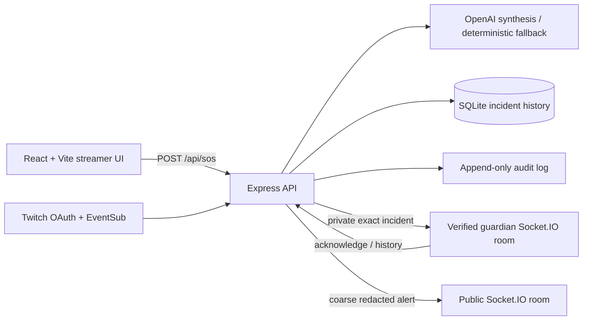

# FULE — Futuristic Use of Live Entertainment

FULE is a Twitch-centered women's safety and civic guardian network. The **FULE Protect** hackathon MVP lets a streamer raise a simulated SOS, sends a structured alert to verified guardians in real time, and records the incident for later review.

> **Responsible use:** FULE supplements, but does not replace, emergency services (112). This hackathon prototype does not contact emergency services and must not be relied on during a real emergency.

## Architecture



The frontend is React + Vite. The backend is Node.js + Express + Socket.IO. `shared/incident.mjs` defines the shared incident schema and public redaction. SQLite at `backend/data/incidents.sqlite` persists incident state and history. The data directory also contains hashed guardian invites and the audit log. Configure `FULE_DATA_DIR` to a persistent volume in deployment.

Precise coordinates and private incident details are delivered to verified guardians only. Public alerts are anonymized/coarse. OpenAI receives coordinates rounded to two decimal places. Secrets remain on the backend.

## Local quickstart

Requirements: Node.js 22.5+ and npm. From the repository root in PowerShell:

```powershell
npm run install:all
Copy-Item .env.example backend/.env
Copy-Item frontend/.env.example frontend/.env
npm run dev
```

Open `http://localhost:5173`. The frontend uses port 5173 and the API/Socket.IO server uses port 4000. Keep `DEMO_MODE=true` in `backend/.env` and `VITE_DEMO_MODE=true` in `frontend/.env` for local demonstration. The demo invite comes from `FULE_DEMO_GUARDIAN_INVITE` in `backend/.env`; the sample value is local demo-only. Change it for your local run. Set both demo flags to `false` for real Twitch login and geolocation requirements. Never enable demo mode or use the sample invite on a public deployment.

## 60-second demo walkthrough

Start both servers with `npm run dev`, open the dashboard, and use the invite configured by `FULE_DEMO_GUARDIAN_INVITE` in `backend/.env`.

1. **0–8 sec — Orient:** Point out the **DEMO MODE** label, the FULE Protect hero, and the guardian alert panel. Explain that all seeded identities and locations are synthetic.
2. **8–18 sec — Choose a scenario:** In **Demo Triggers**, select **Walking alone at night**. Show the editable transcript and select **Button SOS** as the trigger source.
3. **18–30 sec — Trigger:** Click **Button SOS**. Show the incident card appearing immediately with threat level, concise summary, simulated area and 10-second cancel window. The public view receives only anonymized information.
4. **30–40 sec — Safety controls:** Point out the cancel toast and loud alarm toggle. If the alarm is enabled, browser audio permission may be needed. Cancel the first simulated alert inside the grace period to demonstrate the cancel event.
5. **40–53 sec — Guardian response:** Trigger once more and, in the verified guardian panel, show the alert state and click **ACKNOWLEDGE & DISPATCH**. The incident state and audit history update; demo actions do not contact anyone.
6. **53–60 sec — Close:** Show **Logs** / **Incident history** and the privacy notice. State that SOS records persist in SQLite and that FULE supplements, but does not replace, emergency services (112).

To demonstrate alternate simulated sources, choose **!sos chat** or **Silent SOS redeem** in Demo Triggers; these are demo-source simulations, not live Twitch chat/redeem events.

## Twitch setup

1. Create a **Confidential** app in the [Twitch Developer Console](https://dev.twitch.tv/console/apps). For local testing, register `http://localhost:4000/auth/twitch/callback` as its OAuth Redirect URL.
2. In `backend/.env`, set `TWITCH_CLIENT_ID`, `TWITCH_CLIENT_SECRET`, and `TWITCH_REDIRECT_URI` to the exact registered callback. Keep secrets server-side. Set `FRONTEND_ORIGIN=http://localhost:5173`.
3. Set `DEMO_MODE=false` and `VITE_DEMO_MODE=false`, restart, then use **Connect Twitch**. The authorization requests chat, redemption read/manage, and clip scopes; the extra manage scope is needed to create the Silent SOS reward when missing. Channel Points rewards require an eligible Affiliate or Partner channel.
4. EventSub accepts broadcaster-authored `!sos` and `!safe`, suppresses repeated commands, and listens for the configured Silent SOS reward. On SOS it requests a clip and polls up to 10 seconds; offline channels continue without clip evidence.
5. For Twitch embeds, the player reads `window.location.hostname` as its `parent`. Add the exact production app hostname to Twitch's permitted embed domains when required and use the real deployed URL to verify playback.

For Vercel + Render configuration, CORS, cookie, redirect URI, and persistent SQLite setup, see [DEPLOYMENT.md](DEPLOYMENT.md). `frontend/vercel.json` contains SPA fallback routing and `render.yaml` defines the backend service and disk.

## Run tests and build

```powershell
npm --prefix backend test
npm --prefix frontend test
npm --prefix frontend run build
```

## Demo-only configuration

`DEMO_MODE` is a backend environment variable; `VITE_DEMO_MODE` is a frontend build-time environment variable. Use `true` only for local or explicitly labelled judging demos. `FULE_DEMO_GUARDIAN_INVITE` seeds a hashed demo invite only while backend demo mode is enabled. Do not set this invite on public deployments. The demo data, coordinates, trigger sources, and responder profiles are fictional.
