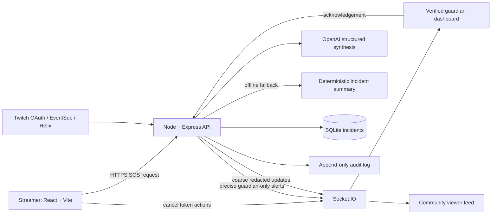

# FULE — Devpost submission

## Project description

**FULE (Futuristic Use of Live Entertainment)** turns Twitch's live, participatory community into a consent-led safety check-in and guardian response network. Our primary module, **FULE Protect**, gives a streamer a one-touch simulated SOS flow, sends a structured alert to verified guardians in real time, and records state changes so responders can coordinate and review an incident.

FULE is a hackathon prototype, not an emergency dispatch service. It does not contact emergency services. It supplements, but does not replace, emergency services (112).

## Problem

During a distressing public moment, someone may need a fast way to signal trusted people without composing a message or revealing sensitive details to a broad audience. A livestream community already has moderators, viewers and live context, but those pieces are not normally organized into a privacy-aware, auditable response workflow.

## Solution

FULE uses a streamer-triggered SOS and a verified guardian channel to turn community attention into a structured response: the streamer can cancel during a short grace window, guardians see context and acknowledge, AI can summarize the transcript, public updates stay coarse and redacted, and incident history survives backend restarts in SQLite.

## Features

- Mobile-ready SOS controls with a 10-second cancel window and optional audible alarm.
- Guardian invite verification, private real-time alerts, acknowledgement and escalation timer.
- Three simulated demo trigger sources: button, `!sos` chat, and Silent SOS redemption.
- Twitch OAuth, broadcaster-authored chat commands, Channel Points redemption, EventSub reconnection and optional clip evidence when configured with credentials.
- AI incident synthesis with a deterministic offline/demo fallback.
- Public/guardian data separation, coarse public locations, and a persisted incident history/audit trail.
- Responsive Twitch-style dashboard with stream cards, guardian directory, categories, alerts, network panel and anonymized map visualization.

## How we used OpenAI Codex

We used OpenAI Codex as an iterative engineering collaborator across the build. We supplied the product concept and project rules, asked Codex to inspect the existing repository before implementation, and used it to shape the architecture and shared incident schema. Codex helped implement and refine the React dashboard, Express and Socket.IO incident pipeline, guardian verification, Twitch OAuth/EventSub integration, privacy filtering, AI structured summaries with offline fallback, and deployment/documentation setup. We then asked Codex to audit behavior against tests and local UI flows, fix prioritized findings, add mocked integration and frontend tests, and prepare the Devpost materials. Human review remained responsible for product decisions, Twitch account setup, deployment secrets, and judging-demo claims.

## Challenges

- **Balancing speed with privacy:** guardians need actionable details while a public audience should not see precise coordinates or private context.
- **Resilient live integrations:** Twitch OAuth, EventSub reconnects, chat/redeem sources and asynchronous clips can fail independently; the demo must still operate offline.
- **Keeping the demo honest:** seeded profiles, coordinates and trigger sources must be clearly identified as synthetic and must not imply a real emergency response.
- **Durable incident history:** backend memory alone loses context after restarts, so incident state is stored in SQLite on a persistent deployment volume.

## What's next

- Complete an end-to-end test using the team's authorized Twitch channel and deployed Vercel/Render domains.
- Add a guardian presence/qualification workflow and consent-based trusted contact escalation.
- Add encrypted evidence retention, explicit retention controls and audited deletion.
- Improve network resilience with a managed Socket.IO adapter and operational monitoring for multi-instance deployment.
- Run accessibility and threat-model reviews with safety advocates before any real-world pilot.

## Architecture

## 60–90 second demo video shot list

| Time | Shot / action | Narration focus |
|---|---|---|
| 0–8s | Open FULE dashboard; frame the hero, DEMO MODE badge and guardian alert panel. | “FULE turns a live community into a privacy-aware safety check-in network. This is a synthetic demo.” |
| 8–18s | Show **Demo Triggers**; choose **Walking alone at night** and show the transcript and source controls. | Explain that button, chat and redeem sources share the same incident pipeline. |
| 18–30s | Click **Button SOS**; capture the alert appearing and the cancel countdown. | Show quick activation, structured AI summary and the short cancel grace. |
| 30–42s | Show approximate location in the alert and exact pin only after verifying the demo guardian; point at the privacy note. | Explain public redaction versus guardian-only details. |
| 42–54s | Cancel the first demo alert, trigger again, then click **ACKNOWLEDGE & DISPATCH**. | Demonstrate streamer cancellation and guardian state change. |
| 54–66s | Open **Logs** / incident history; show a completed status and persisted record. | Explain SQLite history and audited state changes. |
| 66–78s | Briefly show the Twitch stream stage and the Twitch setup section in the README or deployment guide. | Describe live OAuth/EventSub and optional clips as credential-enabled integrations. |
| 78–85s | End on Responsible use note. | “FULE supplements, but does not replace, emergency services (112). This prototype does not contact responders.” |

For a concise 60-second live judging run, use the timed walkthrough in [README.md](README.md#60-second-demo-walkthrough). All demo identities, map pulses and trigger sources are synthetic.
