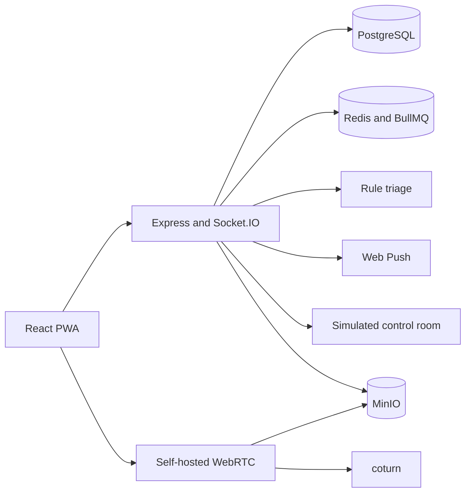

# FULE submission notes

## Devpost description

### Problem

People can feel vulnerable while traveling, and informal community help is hard to coordinate quickly without exposing sensitive details to everyone.

### Solution

FULE is a self-hosted safety network that lets a member raise an in-app SOS, privately notify approved guardians, share a consent-based live incident room, and preserve tamper-evident evidence. Public notices are anonymized. Rule-based triage exposes its factors rather than presenting a model's guess as fact.

### Features

- In-app hold, keyboard, and shake SOS triggers.
- Rule-based incident severity and action recommendation.
- Private guardian alerts, acknowledgements, escalation timeline, and simulated control room.
- Optional self-hosted media, encrypted evidence, and hash-chain verification.
- Demo mode with synthetic location and a generated looping stream.

### How Codex was used

Codex collaborated throughout the build: repository review, architecture and data-model work, implementation iterations, responsive UI refinement, test creation, bug fixes, and documentation. The team reviewed the generated changes, selected product behavior, and owns deployment and demo claims.

### Challenges

The key tradeoff is fast alert delivery with strict location privacy. FULE sends an initial guardian alert without waiting for synthesis, keeps precise coordinates out of public notices, and makes infrastructure failures visible while preserving the in-app response path.

### What's next

Run a privacy and threat-model review, validate mobile network behavior, test recovery from service restarts, and benchmark a measured deployment before inviting real users.

## Architecture

## 60–90 second demo video

| Time | Shot | Narration |
|---|---|---|
| 0–10s | Home dashboard and privacy copy | “FULE helps people ask a trusted local circle for help, with private incident details.” |
| 10–22s | Hold SOS; show generated test feed | “Demo mode uses synthetic data and a generated stream, so the flow works without a camera.” |
| 22–38s | Guardian drawer and severity summary | “The transparent rules provide a concise triage summary while guardians get the private alert.” |
| 38–52s | Acknowledge and show escalation timeline | “A guardian can acknowledge and coordinate; unresolved incidents move through the visible ladder.” |
| 52–68s | Simulated dispatch control room | “This control room is a simulation. The one-tap 112 control opens the device dialer.” |
| 68–82s | Evidence integrity view and architecture | “Evidence hashes make later tampering detectable, and every component can be self-hosted.” |

## Demo safety statement

The demo does not contact authorities or contacts. FULE supplements, not replaces, emergency services (112).
