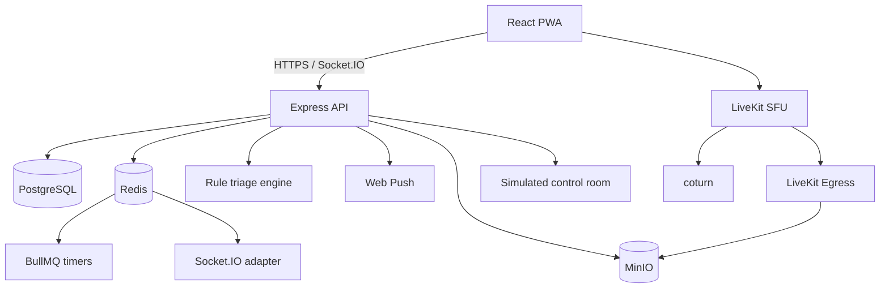

# FULE architecture

The backend validates all user input, creates a private incident, emits a redacted public notice and a full guardian-room notice, and schedules durable escalation work. PostgreSQL stores accounts, incidents, guardian approvals, audit events, and evidence-chain metadata. Redis carries socket fan-out, rate limits, and jobs. The file-backed demo path is available when external infrastructure is intentionally omitted.

Access tokens are short-lived; refresh credentials rotate and are stored as hashes. Roles are `user`, `guardian`, and `admin`. Guardian status is granted only after an administrator approves a pending request. Live media grants are signed for one incident and a specific participant role, with a short lifetime. Stream records go to object storage and their hashes are chained in append-only evidence metadata.

Public incident payloads use coarse coordinates and omit transcripts/private response details. Exact coordinates and evidence are limited to verified responders and explicitly authorized contacts. User-initiated emergency calls use the device dialer; the dispatch console is a simulation.

Production deployment requires a hardened host, TLS, durable backups, strong secrets, retention approval, firewall rules, and measured capacity. See [README](../README.md) for local configuration and resource notes.
