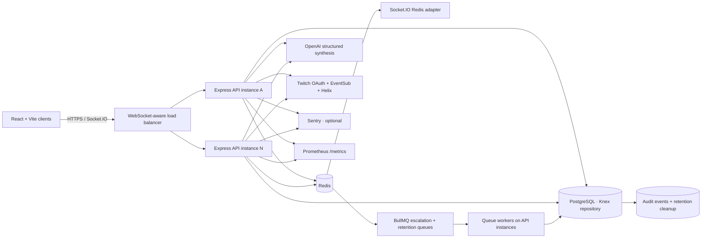

# FULE production architecture

## Data and trust boundaries

- `incidentRepository.js` is the storage seam. Production requires PostgreSQL; demo and tests can use the local JSON adapter. Knex applies versioned migrations at backend startup.
- PostgreSQL is authoritative for incidents, trusted contacts, false-alarm counts, accounts, refresh tokens, idempotency records, and audit events. Redis coordinates shared limits, Socket.IO broadcasts, and durable delayed jobs.
- BullMQ jobs use stable per-incident job IDs. Handlers re-check current incident state before sending trusted-contact or dispatch actions; a guardian acknowledgement/cancel removes delayed jobs when still pending.
- `shared/incident.mjs` redacts exact coordinates and private details from public Socket.IO updates. Verified guardian room and dispatch-control access stay authenticated.
- Email passwords use bcrypt; API access tokens are short-lived JWTs and refresh tokens are random, rotated, and stored as SHA-256 hashes. Guardian role is granted only after admin approval.
- Twitch OAuth access/refresh credentials are AES-GCM encrypted in PostgreSQL when durable storage is active. Twitch session cookies are short-lived signed tokens. A Redis lease limits each broadcaster's EventSub socket to one API instance.
- Local demo and tests remain explicitly non-production. Production boot fails without PostgreSQL, Redis, and a strong JWT secret.

## Operational endpoints

- `GET /api/health`: liveness.
- `GET /api/ready`: PostgreSQL and Redis readiness.
- `GET /metrics`: Prometheus counters, gauges, and histograms; protect with `METRICS_TOKEN` and network policy.
- JSON request logs include an `x-request-id`; optional Sentry integration uses `SENTRY_DSN`.
- Hourly queue job removes incidents, audit events, and idempotency records older than `INCIDENT_RETENTION_DAYS` (default 90) plus expired/revoked refresh tokens.

## Known capacity controls

PostgreSQL pool size is per instance (`PG_POOL_MAX`), so total configured pools must fit the database connection cap. PostgreSQL and Redis network round-trips, Twitch/OpenAI providers, signed dispatch webhook retries, Node CPU, and websocket egress are expected bottlenecks to quantify with the k6 harness. See [the measured load report](../LOAD_TEST_REPORT.md); blank results are intentionally not estimated.
